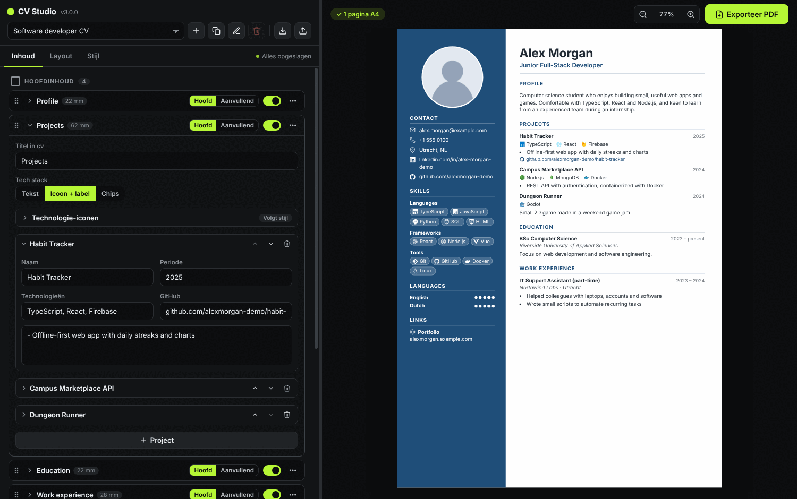
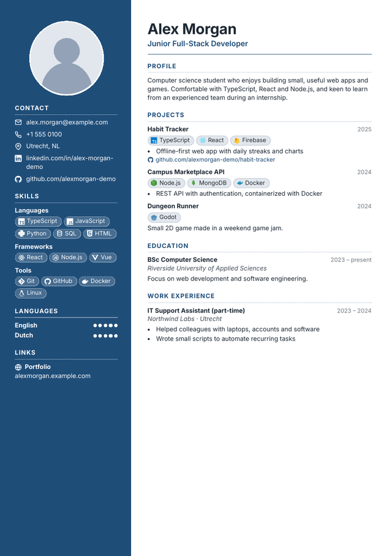
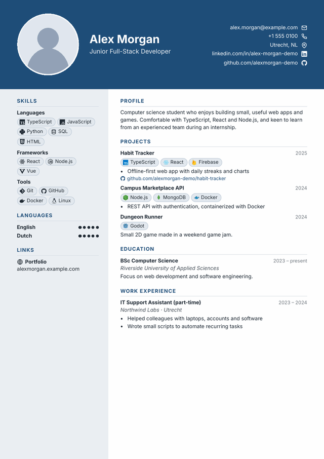
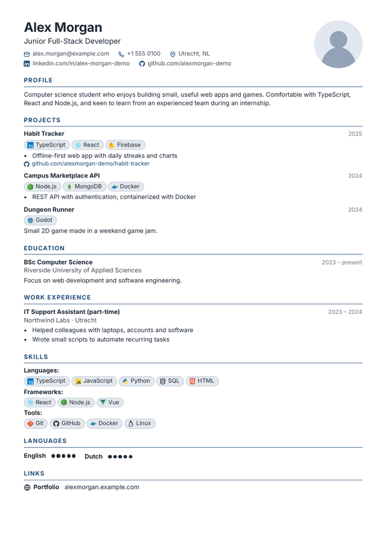
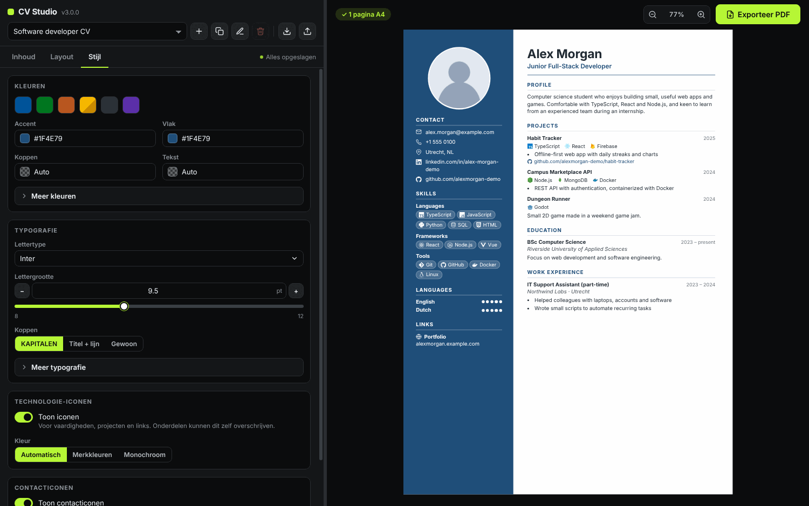

# CV Studio

A free, offline CV builder for Windows. Fill in your details, pick a template and export a clean one-page PDF.

[](LICENSE)
[](https://github.com/FarmaanFJM/cv-studio/releases)




- **One page, always.** The preview is a true A4 page. CV Studio tells you which section is too long, and the exported PDF is checked to be exactly one page.
- **See every change instantly.** Edit on the left, watch the CV update on the right.
- **Your data stays on your computer.** No account, no cloud, no tracking. It works without an internet connection.

## Download

1. Open the [releases page](https://github.com/FarmaanFJM/cv-studio/releases) and download `CV-Studio-Setup-<version>.exe` from the newest version. Releases are currently marked as pre-releases.
2. Run the installer.
3. Start CV Studio and create your CV.

> [!NOTE]
> The installer is not code-signed yet, so Windows SmartScreen may show a warning. Choose **More info**, then **Run anyway**.
>
> Release builds are currently created on Linux with Wine and automated tests. They have not been verified end to end on a native Windows machine, so please [report any problem](https://github.com/FarmaanFJM/cv-studio/issues/new/choose) you run into.

The application interface is currently in Dutch. Section titles on your CV can be renamed freely.

## Features

**Layout and templates**
- Live A4 preview with zoom
- Three templates: Sidebar, Header and Minimal
- Hoofdinhoud (primary) and Aanvullende inhoud (supplementary) areas, so each template decides where supplementary content appears
- Adjustable margins, spacing, sidebar width and date positions

**Content**
- Personal details, profile, work experience, education and projects
- Skills as a list, in groups or by level, shown as text, chips or with icons
- Languages with levels or dots, plus custom sections for anything else
- Profile photo with crop, zoom, round or square shape

**Design**
- 15 bundled fonts with search
- Color picker with hex input, saved colors and contrast checks
- Technology icons with original brand colors or a single color, set globally or per section
- Contact icons for email, phone, location, LinkedIn, GitHub and website

**Files**
- Several CV versions, for example one per application
- Automatic local saving
- JSON import and export for backups
- PDF export with selectable text

## Templates

<p align="center">
  <a href="docs/images/template-sidebar.png"></a>
  <a href="docs/images/template-header.png"></a>
  <a href="docs/images/template-minimal.png"></a>
</p>

- **Sidebar**: a strong colored side area for photo, contact details and skills. Good for a visual, modern CV.
- **Header**: a wide header with your photo and name. Good when you want a clear first impression.
- **Minimal**: one clean column without decoration. Good when the CV may be read by applicant tracking software.

All three show the same fictional example CV.

## How to use

1. **Content**: enter your personal details, then add education, experience, skills and projects. Drag sections between the primary and supplementary areas, or hide the ones you do not need.
2. **Layout**: choose a template and adjust margins, spacing and photo size.
3. **Style**: pick colors, a font and how technology icons look.
4. Check the page indicator above the preview. If a section is too long, it is highlighted and **Exporteer PDF** stays disabled until the CV fits on one page.
5. Click **Exporteer PDF**.

<p align="center">
  
</p>

## Privacy and offline use

CV Studio has no account system, no analytics and makes no network requests while you work. Fonts and icons are bundled with the app.

Your CVs are saved as a plain JSON file on your computer:

```
%APPDATA%\cv-studio\data\cvs.json
```

The file is not encrypted, so anyone with access to your Windows account can read it. Use **export JSON** (the download icon at the top of the editor) to make a backup and **import JSON** to restore it. Profile photos are stored inside this file.

## Development

CV Studio is built with Electron, React and TypeScript. Vite bundles the interface, electron-builder creates the Windows installer, and the tests use Vitest and Playwright.

You need Node.js 22 or newer.

```bash
npm install          # install dependencies
npm run dev          # start the app with hot reload
npm run typecheck    # TypeScript check
npm test             # unit tests (Vitest)
npm run build        # build the renderer and the Electron main process
npm run test:e2e     # end-to-end tests against the real Electron app (Playwright)
npm run dist         # build the Windows installer into ./release
```

Notes:

- On Linux, run the end-to-end tests with `npm run test:e2e:linux`, which uses `xvfb-run`. The pixel checks of exported PDFs also need `pdftoppm` (Poppler).
- `npm run dist` runs best on Windows. On Linux it needs Wine, and the result has only been smoke tested there, not on native Windows.
- `npm run gen:icons` regenerates the multicolor logos, `npm run licenses` refreshes `licenses/`, and `xvfb-run -a node scripts/docs-assets.mjs` regenerates the images in `docs/images`.

The repository also contains a [Windows build workflow](.github/workflows/windows-build.yml). Hosted Windows runners need available GitHub Actions minutes, and the workflow has not run successfully yet.

### Project structure

| Path | Purpose |
| --- | --- |
| `electron/` | Main process: window, local storage, PDF export, JSON import and export |
| `src/renderer/` | The React app: editor, preview and the CV templates |
| `src/renderer/ui/` | Reusable `Summa*` interface components (buttons, toggles, sliders, color picker and more) |
| `src/renderer/editor/` | Editor panels for content, layout and style |
| `src/renderer/templates/` | CV rendering and template styles |
| `src/shared/` | Data model, migrations, color helpers and technology icon rules, shared by the app and the tests |
| `tests/` | Unit tests |
| `e2e/` | End-to-end tests |
| `scripts/` | Build, icon, license and documentation image scripts |
| `licenses/` | License texts of bundled fonts, icons and libraries |
| `docs/` | Images used in this README |
| `.github/` | Issue templates, pull request template and the Windows build workflow |

## Contributing

Bug reports, feature ideas, documentation fixes and pull requests are welcome. Please read [CONTRIBUTING.md](CONTRIBUTING.md) first. When you report a bug, steps to reproduce make it much easier to fix, and please do not share real personal CV data.

## License and acknowledgements

CV Studio is released under the [MIT License](LICENSE).

Bundled third-party material keeps its own license, see [THIRD_PARTY_NOTICES.md](THIRD_PARTY_NOTICES.md):

- Fonts from [Fontsource](https://fontsource.org) (SIL Open Font License 1.1)
- Multicolor technology logos from [devicon](https://github.com/devicons/devicon) (MIT)
- Single-color logos from [Simple Icons](https://github.com/simple-icons/simple-icons) (CC0)
- Some interface icons from [Feather](https://github.com/feathericons/feather) (MIT)

CV Studio is not affiliated with the owners of the technology brands whose logos can appear in a CV. Logos and names are trademarks of their respective owners.
